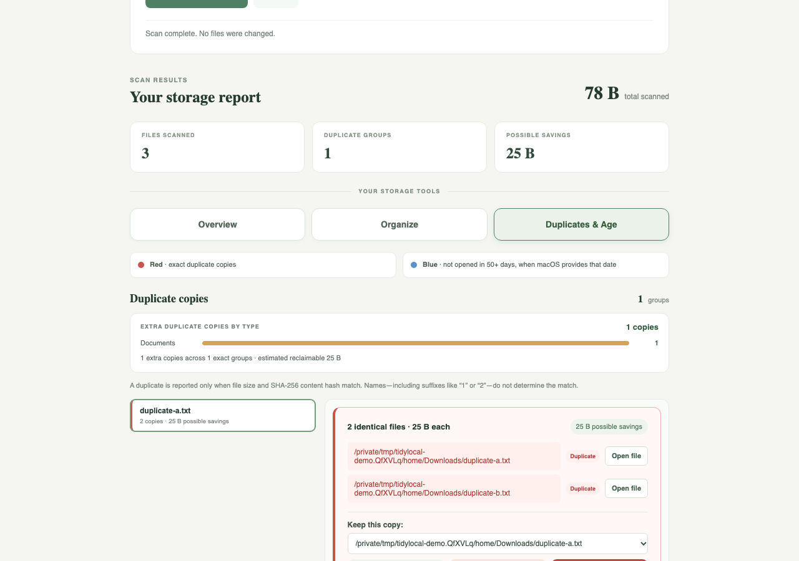

# TidyLocal

<p align="center"></p>

[](https://github.com/mamguitar2/TidyLocal/actions/workflows/tests.yml)
[](https://www.repo-grade.com/report/mamguitar2/tidylocal)

TidyLocal is a local-only macOS file review and organization app. It scans only locations you select, summarizes storage and exact duplicates, and suggests safe file moves. Nothing is moved or sent to a service without an explicit user action. The web app binds to `127.0.0.1` and keeps scan data on the Mac.

## Preview



This screenshot uses synthetic text files in an isolated temporary home directory; no personal folders or files were scanned. TidyLocal is intentionally local-only, so there is no public hosted instance. The screenshot and [quick-start steps](#quick-start-macos) are the safe preview.

## Quick start (macOS)

Requires Python 3.10 or newer. Clone the repository, create a virtual environment, and install runtime dependencies:

```sh
git clone https://github.com/mamguitar2/TidyLocal.git
cd TidyLocal
python3 -m venv .venv
.venv/bin/python -m pip install -r requirements.lock
```

Launch by double-clicking **Open TidyLocal.command**, or run `.venv/bin/python launch.py` from Terminal. Open `http://127.0.0.1:8000`. Stop the server with Ctrl-C. To use another port, set `TIDYLOCAL_PORT` before launching. The app never starts a scan or file action automatically. Opening `templates/index.html` directly with a `file://` URL only displays a static file; it cannot start the backend. macOS may ask for folder access when you explicitly start a scan.

## Usage

1. Select the approved locations (Downloads, Desktop, Documents) and click **Scan**.
2. In **Organize**, choose destination folders, then review files with a clear organizing suggestion. Uncertain files are omitted from the action list.
3. In **Duplicates**, review exact content matches and explicitly choose whether to keep, trash, or leave copies.
4. Move actions ask for confirmation. Trash is reversible through macOS Trash; ordinary moves can be undone when the source and destination still match the safety checks.

## Development and tests

From a fresh checkout, install the locked development dependencies and run the suite with `make test`:

```sh
.venv/bin/python -m pip install -r requirements-dev.lock
make test
```

The suite uses pytest temporary directories for filesystem tests. Run all contributor checks (also run in CI) with `make check` and `make test-coverage`.

The bounded manifests `requirements.txt` and `requirements-dev.txt` describe allowed versions; the committed `requirements.lock` and `requirements-dev.lock` pin the full transitive dependency sets for repeatable installs. Regenerate both locks when changing the manifests:

```sh
uv pip compile --universal --no-annotate requirements.txt -o requirements.lock
uv pip compile --universal --no-annotate requirements-dev.txt -o requirements-dev.lock
```

GitHub Actions validates the locked install on macOS/Python 3.10 and 3.12.

## Limitations

TidyLocal is macOS-first; Finder reveal and application metadata are macOS-only. It does not permanently delete files, overwrite destinations, uninstall apps, or automatically restore Trash contents. File moves fail closed if the operating system cannot provide an exclusive no-overwrite rename. Organizer suggestions are conservative: uncertain items stay untouched. Activity logs are local but not encrypted. The optional Ollama integration is off by default and contacts only a loopback endpoint.

## Privacy and scope

- Scanning starts only after you click Scan; Desktop is preselected as a starting point, and you can change the approved locations first. The server accepts only Downloads, Desktop, and Documents identifiers; it accepts no browser-supplied paths.
- Scans enumerate regular files only, skip symlink files/directories and `.app` bundles, and stay under resolved approved roots. Permission failures are reported without aborting the full scan.
- Scanning and organizer previews do not change files. Each organizer move requires its own button click and confirmation. Sources must be present in the latest scan, match saved file identity, be regular non-symlink files, and remain inside approved roots. App/project/system paths are protected.
- Organizer suggestions use filenames, extensions, and bounded local text extraction (UTF-8 text, RTF, HTML, DOCX, and ODT). No file contents are sent to an AI or network service. Categories are Taxes, Finances, Career, and Personal (Music, Bad Caddy Apparel Co, Rent, Power of Attorney, Wedding). Matching existing destination folders are reused. Ambiguous items and already-organized files are omitted from the action list. Destinations stay under approved scan roots. Moves preserve names, use exclusive OS rename primitives, and never overwrite. Newly created empty folders are cleaned up if a category move fails; completed moves are logged and can be undone subject to identity and destination checks. Create-folder accepts one safe name. Finder reveal is macOS-only. Trash uses `send2trash`; if unavailable it fails safely. Trash restoration is manual in Finder. Undo uses unique operation IDs and removes only the same still-empty folder created by the app.
- Activity records are local JSONL under `~/.tidylocal/activity.jsonl` and excluded from Git. No permanent delete or overwrite operation exists.
- Exact duplicates are size-filtered then SHA-256 hashed; estimated savings are logical bytes and can overstate space reclaimed on APFS, with clones, compression, or hard links.
- Scans run in background jobs with status and cancellation endpoints. Mutating scan-start/cancel POSTs require loopback Host and matching Origin checks.
- Disk capacity is queried locally from the system filesystem. Nothing is uploaded; there are no paid APIs or telemetry integrations.
- `POST /api/demo` explicitly creates harmless placeholders only inside an OS temporary directory; it is not run automatically and never writes into personal folders or the repo.
- Optional macOS app review enumerates only `/Applications` and `~/Applications`, estimates bundle size without following symlinks, and reports `Unknown` where metadata is unavailable. Last-used is never inferred from modification time; it uses `mdls` metadata only. No uninstall feature or administrator access exists.
- Ollama explanations are disabled by default. An explicit toggle is required; only category/type, size, and short review reason are sent to a loopback HTTP endpoint. Basenames, paths, and contents are excluded. Remote endpoints are rejected; failures/timeouts are surfaced. AI output cannot trigger operations.
- Fonts may be fetched from Google Fonts by the browser; for offline use, the layout falls back to system sans-serif fonts. No app data is sent by this font request.

## Architecture

`app.py` exposes FastAPI routes and disk metrics; `scanner.py` contains read-only scan primitives; `organizer.py` classifies names, file types, and locally readable text into conservative category suggestions. The vanilla frontend keeps an Overview, Organize, and Duplicates & age view. Local charts summarize storage by file type, top-level folders, and duplicate copies by type. Organize is a two-step flow: choose destination folders, then review files with a clear organizing action. Uncertain files are kept out of that action list. A ChatGPT Atlas installer can be moved to Trash without uninstalling an app. Duplicate groups offer three explicit choices: leave copies in place, keep one and Trash the rest, or Trash all. File types are inferred locally from extensions; operating-system metadata such as `.DS_Store` and AppleDouble sidecars are excluded from reports and organizing suggestions. Moves occur only after an individual review and confirmation; uncertain files remain untouched until manually classified. Tests cover disk metrics, demo-folder isolation, scan classification, duplicate hashing, symlink/bundle exclusion, whitelist/origin validation, job status, failed-move cleanup, and approved-root confinement.

## License

TidyLocal is licensed under the MIT License. See [LICENSE](LICENSE).
